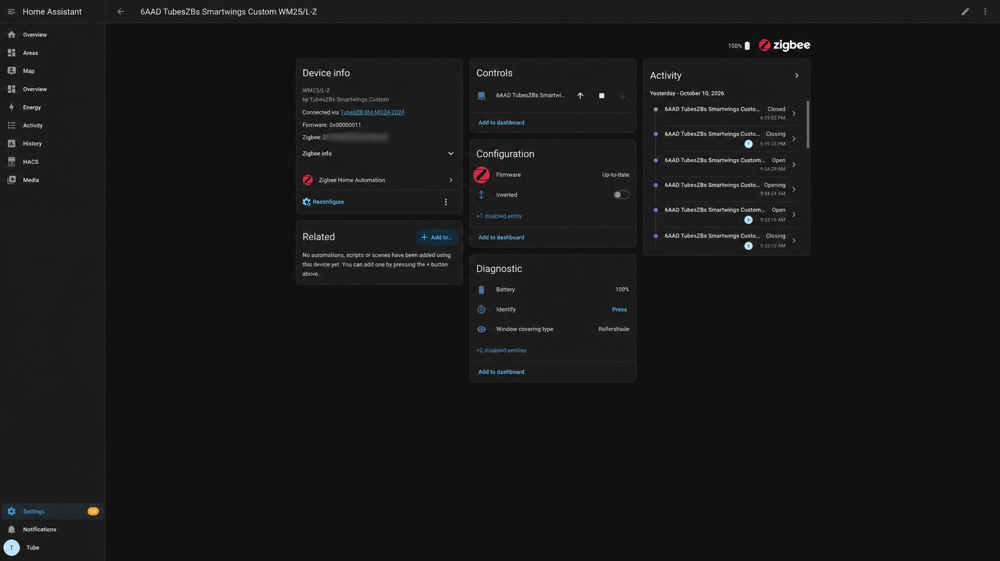
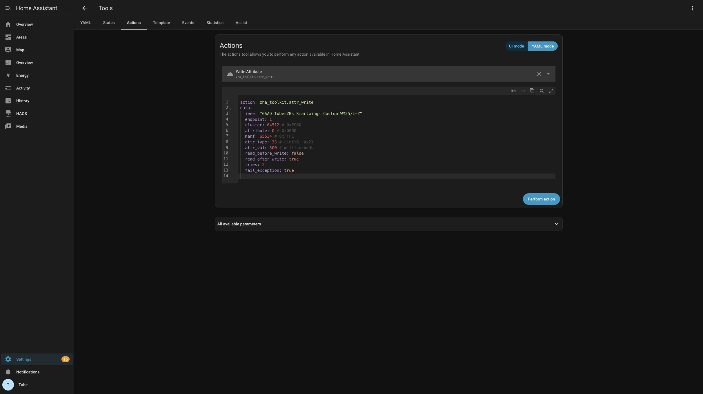

# SmartWings Custom Firmware — Q17

Custom Zigbee firmware for the Tuya ZS13S / EFR32MG21A020F768IM32 module for the SmartWings WM25/L-Z lift motors. Manufacturer: **TubesZBs Smartwings Custom**. Model: **WM25/L-Z**. Firmware version: **17 / 0x00000011**.

Radio specifications:
Part Number    : EFR32MG21A020F768IM32
Flash Size     : 768 kB
SRAM Size      : 64 kB

This repository contains an application, custom Gecko bootloader, initial combined image, configuration/source inputs and host tests. It is an independent project not related to or affiliated with Smartwings. Compatibility with other motor models is unverified. Vendor-source redistribution permissions still need confirmation before publishing this snapshot; see [licensing](NOTICE.md).

AI was used to create this README and all accompaning documentation. AI generated content was checked and edited for accuracy and clearness. All research, implentation and testing was done with my prompting and guidence.



## Why this project exists

[In March of 2023](https://github.com/zigpy/zha-device-handlers/pull/2220) I had issues with my new Smartwings blinds and Smartwings supplied replacement modules for 2 units. I believe my issues were related to device firmware around inversion. I dumped a firmware from one of the modules at that time. A recent (Oct 2026) email requesting a copy of the dumped firmware prompted me to start an AI assisted investigation into the feasibility and implementation of a custom firmware.

The tested stock setup had reversed-direction behavior, poor responsiveness, and nonfunctional group and scene clusters. Native device settings and useful battery/position reporting were also priorities. SmartWings support was contacted to understand if any other motor features were available and to confirm the motors report position and battery after movement finishes. They had no comment on other motor functions and recommended replacement motors or SmartLink Pro for the direction/group issues. This project replaces the Zigbee module's firmware; the motor controller remains unchanged.

This project's goal is a custom application for a sleepy end device with 250 ms default polling, standard Window Covering and battery attributes, persistent Inverted mode, motor-triggered joining, native Groups/Scenes storage and OTA updates after initial installation. No Home Assistant quirk is required. [Polling is adjustable with direct cluster writes.](docs/POLL_RATE.md)

**Group multicast is still a known limitation:** Initial testing with 2 honeycomb shades. Both devices were added to group 2 and reported group 2 membership, but several group broadcast scene recall tests did not move them. Unicast Addressed scene recalls worked on both. [Home Assistant helper groups issuing individual commands were observed to respond closely together](docs/videos/two-shades-helper-group.MOV). Do not treat this release as proven reliable multicast group control.

Long-term testing has not yet been completed; reliability and battery endurance remain to be validated.

## Release files

Files are in [`firmware/Q17`](firmware/Q17). Verify their SHA-256 hashes with `python tools/verify_release.py` before flashing.

| File | Purpose |
| --- | --- |
| `smartwings-Q17-combined.s37` | First installation: custom bootloader + application + blank custom NVM3. **Resets pairing and saved settings/scenes.** |
| `smartwings-Q17-initial.hex` | Equivalent first-install image in Intel HEX format; the hardware-tested initial image |
| `smartwings-Q17-app.s37` / `.hex` | Application-only SWD update on the custom layout |
| `smartwings-bootloader.s37` / `.hex` | Custom bootloader; actual image table version 3.2.0 |
| `smartwings-Q17-update.s37` | Bootloader + application, without explicit NVM reset; for an already custom-layout device |
| `smartwings-Q17-app.ota` | Zigbee OTA container for devices already running compatible custom firmware |
| `.bin`, `.elf`, `.gbl` | Raw images, debug symbols, Gecko update container; prefer addressed HEX/S37 for SWD |

The SDK is 2026.6.1 / Zigbee 9.1.1. The bootloader image's own version is 3.2.0; SDK/package version labels do not change that value.

## First installation with Commander

Download [Simplicity Commander from Silicon Labs](https://www.silabs.com/software-and-tools/simplicity-studio/simplicity-commander). Windows, macOS and Linux are supported. Add its executable directory to PATH or replace `commander` below with its full path. On Windows its filename is `commander.exe`; PowerShell needs `&` before a quoted executable path.

Disconnect the motor for initial flashing. Power the module from regulated **3.3 V** with one power source and shared ground. Connect SWDIO (PA02), SWCLK (PA01), GND and target voltage reference; supply wiring depends on your debugger. The radio must never receive the motor pack's 10.8–12 V. See [hardware and pin mapping](docs/HARDWARE.md), including [carrier pinout and flashing photos](docs/HARDWARE.md#carrier-board-photograph).

The examples assume one connected WSTK/J-Link and use the exact target below. This procedure assumes debug access is already unlocked. Do not erase or unlock a device without its backup.

```text
commander --version
commander device info --device EFR32MG21A020F768IM32
```

Make a separate backup directory for **each module**, preserving previous backups. Save device and security information using your shell's output redirection or copy their output into that directory. Save complete main flash and the factory regions:

```text
commander device info --device EFR32MG21A020F768IM32
commander security status --device EFR32MG21A020F768IM32
commander readmem --range 0x00000000:+0x000C0000 --outfile backups/MODULE/mainflash.bin --device EFR32MG21A020F768IM32
commander readmem --range 0x0FE00000:+0x400 --outfile backups/MODULE/userdata.hex --device EFR32MG21A020F768IM32
commander readmem --range 0x0FE08000:+0x400 --outfile backups/MODULE/devinfo.hex --device EFR32MG21A020F768IM32
python tools/hash_files.py backups/MODULE
```

Memory reads may halt the core. Complete backup before resetting or programming. Do not share dumps: they can contain device identity and Zigbee credentials. [Commander memory-read reference](https://docs.silabs.com/simplicity-commander/latest/simplicity-commander-commands/memory-read-commands).

From the repository root:

```text
python tools/verify_release.py
commander flash firmware/Q17/smartwings-Q17-combined.s37 --device EFR32MG21A020F768IM32 --speed 100
commander device reset --device EFR32MG21A020F768IM32
```

Commander verifies programming by default. Do not add `--noverify` or use mass erase. The initial image has no records in factory main-flash page 0xBE000–0xBFFFF, User Data or DEVINFO. Its NVM reset is deliberate.

Reconnect the motor with correct RJ9 wiring and open pairing on your Zigbee coordinator. Trigger motor pairing: hold P1 about six seconds, releasing after the second jog, or use the remote **P → Up → P** sequence. Remove the old coordinator device entry and join/interview afresh after first installation. Check open/close/Stop, feedback and battery reporting. Leave motor limits/calibration unchanged.

## Updates and recovery

For a device already flashed with the custom firmware, application-only SWD updates use `smartwings-Q17-app.s37`; OTA uses `smartwings-Q17-app.ota`. OTA identity is manufacturer 0xFFFE, image type 0x6AAD, hardware version 1. Zigbee file version and application version must increase for a subsequent release; Q17 is not a reinstall-over-Q17 OTA image.

Initial stock-to-custom OTA is blocked by an observed storage mismatch/ stock firmware defect: the stock application stages at **0x66000**, while its bootloader reads **0x44000**. A byte-exact stock restore followed by a complete download failed validation. No supported alternate image-type, mutable storage token or UART entry was found to redirect the download. See [OTA investigation](docs/OTA.md). Initial installation therefore requires SWD. Including a bootloader in an OTA payload cannot solve the first payload's storage mismatch.

To recover the same module's stock main flash, convert its own backup to an addressed image, then flash it over SWD:

```text
commander convert backups/MODULE/mainflash.bin --address 0x00000000 --outfile backups/MODULE/original-mainflash.s37
commander flash backups/MODULE/original-mainflash.s37 --device EFR32MG21A020F768IM32 --speed 100
```

Restore only that module's verified backup. Do not clone another module's factory identity or network keys. Factory regions should not need rewriting when preserved by this procedure.

## Configuration and measured results

Endpoint 1, manufacturer-specific cluster **0xFC00**, manufacturer **0xFFFE**, attribute **0x0000**, type **uint16 (0x21)** configures idle polling in milliseconds. Supported values: **250, 500, 750, 1000**. Use a manufacturer-specific direct attribute write; the value persists. Default is 250 ms. Fast polling is 100 ms during active exchanges. This custom control cluster is distinct from the standard Poll Control cluster; no slider entity or quirk is required.

The built-in ZHA attribute editor has no definition for this custom attribute without a quirk. For a typed write without a quirk, see the [Home Assistant poll-rate guide](docs/POLL_RATE.md), which uses the separately installed ZHA Toolkit. The screenshot below prepares a 500 ms example; it was **not executed**.



Historical WSTK AEM measurements at 3.3 V were about 205.9 / 112.7 / 83.8 / 69.2 µA at those four intervals; a repeated 250 ms capture was 242.8 µA with extra activity. These are module measurements, not whole-shade battery endurance. A battery was disassembled/removed from the metal casing, and was labeled as 10.8 V, 2500 mAh, 27 Wh. A 60-day endurance target and ≤0.5 s command-delay target remain goals, not full-system guarantees.

Inverted mode persisted after power cycling. Addressed scenes and scene/group persistence were tested. Position and battery reflect motor reports, principally after movement/Stop; no continuous motion estimate or motor battery ADC is added.

## Source and build

[`app`](app) includes the SLCP, application callbacks, motor bridge, configuration headers, ZAP configuration and custom cluster XML. [`bootloader`](bootloader) includes its SLCP, post-build profile and configuration. SDK source, generated autogen/CMake projects, local tool paths and stock backups are excluded. See [build instructions](docs/BUILDING.md), [UART architecture](docs/ARCHITECTURE.md), [licensing boundary](NOTICE.md), and [hardware/affiliate notes](docs/HARDWARE.md).
