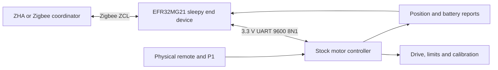

# Motor and Zigbee architecture

The module bridges Zigbee commands to the stock motor MCU. The motor retains its own firmware, drive control, limits, calibration and remote handling. USART0 uses PA5 TX and PA6 RX. Nonblocking TX/RX queues and a length/checksum parser avoid blocking radio processing. Diagnostics use RTT, not the motor's UART.

Frames begin with a length byte and opcode, followed by payload and XOR checksum; XOR of the complete frame is zero. Captured short commands were Open `03 01 02`, Close `03 02 01`, and Stop `03 03 00`. Target-position frames are `0D F1 00 00 00 00 00 00 04 40 PP 00 CC`, with checksum `CC` computed across preceding bytes. The bridge uses target-position control for lift requests.

Motor report 0xF5 conveys position (byte offset 4 of a seven-byte frame); 0xF8 conveys battery percent (byte offset 2 of a four-byte frame). Valid battery percent is converted to the standard ZCL half-percent representation. 0xFA triggers joining, 0xF9 leaving, and 0xFB conveys network-related signaling. Unsupported status meanings are not invented from partially decoded bytes.

Canonical Zigbee lift position is 0% open / 100% closed. Home Assistant displays the opposite percentage convention. Persistent Inverted mode transforms targets and feedback together. Native cluster handlers update attributes and reporting from validated motor frames. Groups and Scenes use SDK membership/scene storage; scene completion is based on reported target position rather than an assumed travel timer.

In EM2, the UART RX edge wakes the module through a GPIO interrupt. A standalone zero precedes captured motor frames by roughly 5–6 ms, allowing the USART clock to recover. A five-second EM1 receive window follows wake; repeated reports help parser recovery. This mechanism and sleepy polling reduce idle radio-module draw while retaining motor-triggered reporting and joining.

Startup sends a Stop and refresh action after approximately one second. Rebooting the module can therefore interrupt motor movement. There is no proven passive battery/position query: attribute reads return cached reports. Do not periodically send Stop to simulate telemetry polling. Actual in-motion feedback is limited by motor behavior.

Application responsibilities: Basic identity, standard Window Covering/Power Configuration, Identify, Groups/Scenes, Zigbee OTA client, and custom polling attribute. The bootloader validates/installs staged GBL images from its matched internal storage slot. NVM3 stores Zigbee state, scenes and custom poll/inversion tokens (0xB000 / 0xB001 within the Zigbee token domain).

| Region | Address range |
| --- | --- |
| Bootloader reservation | 0x00000–0x03FFF |
| Application reservation | 0x04000–0x5BFFF |
| OTA storage slot | 0x5C000–0xB3FFF |
| Reserved gap | 0xB4000–0xB5FFF |
| Custom NVM3 | 0xB6000–0xBDFFF |
| Preserved manufacturing page | 0xBE000–0xBFFFF |

The first-install image resets custom NVM3 but preserves the final factory page, User Data and DEVINFO. Updating an already custom device should preserve custom NVM3. Raw BIN files have no address metadata; bootloader starts at 0 and app at 0x4000.
