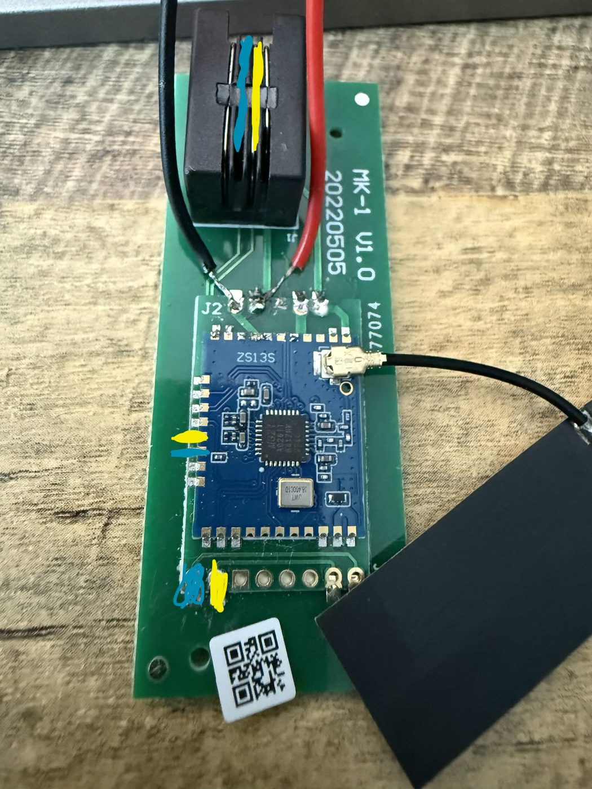
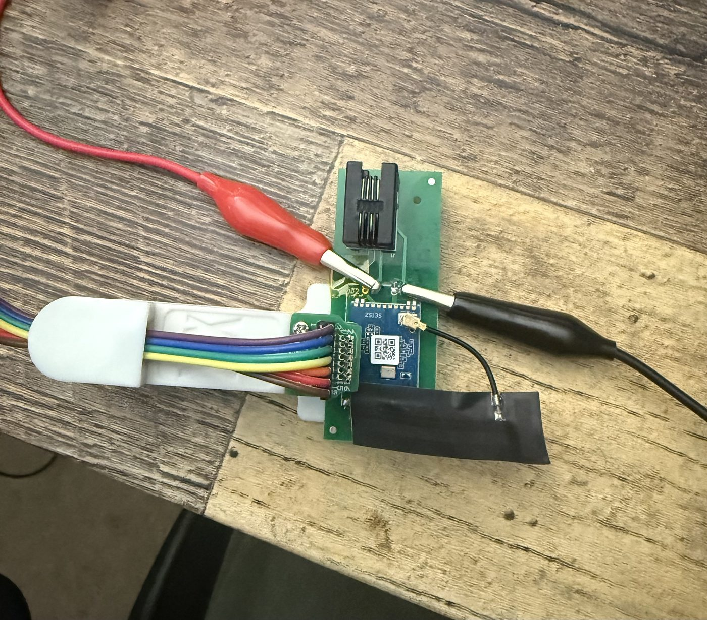

# Hardware and affiliate links

## Debugger choices

* [Simplicity Link Debugger SI-DBG1015A](https://www.silabs.com/development-tools/wireless/simplicity-link-debugger): lower-cost SWD/J-Link option with VCOM/PTI and optional 3.3 V power. Check the [UG548 guide](https://www.silabs.com/documents/public/user-guides/ug548-brd1015a-user-guide.pdf) for its connector and breakout arrangement. It is not an AEM current profiler.
* [Wireless Pro Kit mainboard / WSTK family](https://www.silabs.com/development-tools/wireless/wireless-pro-kit-mainboard): SWD/debugging plus AEM power profiling on the suitable board. Confirm board revision and external-target connector wiring. The project's external-target measurements used OUT mode and measured VAEM power through the Mini Simplicity connector, with the plug-in radio board removed.
* Pogo-pin clip: verify pad pitch, contact count and orientation against the actual module before buying. An appropriate seven/eight-contact clip can reach UART/SWD pads; an unverified marketplace listing is not a recommendation.
* RJ9 **4P4C** cable/coupler: RJ11 hardware is incompatible. Verify continuity and conductor mapping rather than assuming colors or straight/reversed cable wiring.

## Module and carrier pinout

The [Tuya ZS13S datasheet](https://developer.tuya.com/en/docs/iot/zs13s-module-datasheet?id=K9n5ccelflel2) is a starting reference. With the component side facing you, RJ9 at the top and antenna at upper right, the left-side contact row is pads 12 through 19 from top to bottom:

| Pad | Signal |
| --- | --- |
| 12 | PC01 |
| 13 | PA00 |
| 14 | PB00 |
| 15 | Reset |
| 16 | PA5 — module UART TX |
| 17 | PA6 — module UART RX |
| 18 | PA01 — SWCLK |
| 19 | PA02 — SWDIO |

UART adapter TX connects to module RX, and adapter RX to module TX, with shared ground and 3.3 V signaling. A receive-only capture leaves adapter TX disconnected. Pin map is for the tested module; confirm orientation before applying power. SWD requires target power/reference and shared ground even when only two debug signals are used.

The motor battery supply is separate from the 3.3 V radio supply. Do not backfeed power between the motor and debugger. Bench tests with independent radio power isolated the radio supply conductor of the RJ9 cable and verified isolation with a continuity meter. A taped contact must be rechecked after reconnecting; proper cable modification is preferable for a durable fixture.

### Carrier-board photograph

The tested carrier is marked **MK-1 V1.0 / 20220505** and carries the Tuya ZS13S module containing the EFR32MG21. In this photograph, the RJ9 connector is at the top and the antenna connector is at the upper right. The color marks identify the same UART signals at the module pads, the larger carrier pads and the RJ9 contacts:

| Photograph marking | Signal | Module pad |
| --- | --- | --- |
| Yellow | PA5 — module UART TX, toward the motor | 16 |
| Teal/blue | PA6 — module UART RX, from the motor | 17 |

The corresponding soldered/marked carrier pins and pads are also accessible on the opposite side. Their apparent left-to-right positions are **mirrored when viewed from that side**; their electrical signals stay the same. Use the photo's viewing orientation and power-off continuity checks rather than copying a left/right order across sides. The full module-edge mapping, including SWCLK and SWDIO, is listed above; the colors mark UART signals, not SWD signals.

### Flashing connections

This photo shows the edge pogo-pin clip used for access to the module's debug pads, with separate red positive and black ground alligator clips supplying the carrier. The **positive alligator clip has a blob of solder on its tip** to make contact with the positive pin/pad. **Tape covers the negative pad on the left of that contact** to prevent the positive clip from shorting against it. These details describe a solderless bench fixture (outside the solder on the alligator clip — a small ball of aluminum foil was tested as well and worked, but solder was used for repeatability); the tape and solder are contact aids, not additional electrical connections.

Use regulated **3.3 V** for the radio, a shared ground and the SWCLK/SWDIO mapping above. Wire colors on the pogo clip do not establish signal assignments. Confirm clip orientation, polarity and isolation before powering the module. When the motor is connected while the radio is independently powered, isolate its radio-supply conductor as described above.
